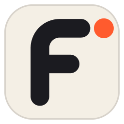

# openFTTH

**open** says it is open source and free to run. **FTTH** says exactly what it designs.

openFTTH is an open-source, local-first desktop app where you talk to an AI crew and it
designs a whole fibre-to-the-home network. Give it a map, an address list or a client GIS
export. It hands back a construction-ready design: routes, chambers, splitters, splice
plans and the bill of quantities.

- **The AI does the work.** A crew of four long-lived agents (Surveyor, Planner, Checker,
  Drafter) reads the inputs, places equipment, routes cables, checks the rules and writes
  the deliverables. The LLM plans, explains and talks; deterministic solvers and rule
  checkers make every engineering decision, so every result can be repeated and audited.
  **The LLM never writes a number into the design.**
- **The human approves.** Every design change is a reviewable diff. Leaving a duct, digging
  a new trench or exporting for construction needs one click. A licensed engineer signs
  the final package.
- **The human can still steer.** Move a cabinet, take a building out, forbid digging on a
  street: each is an engine tool call with the reason on record, the routes are planned
  again and the Checker looks again. Every deliverable saves out of File → Export.
- **Local first.** Everything runs on your machine. Cloud models are optional.
- **Open to other AI apps.** Turn on openFTTH's MCP link (`http://127.0.0.1:3920/mcp`) and
  Claude Desktop, Claude Code, Cursor, VS Code or any MCP client can open projects, design,
  ask the crew and pull the deliverables, with one-click installs ([docs/MCP.md](docs/MCP.md)).

## Status

Phase 1 in progress: the design engine works headless; the agent harness and the Windows app
are being built. Nothing here is usable for real designs yet. See [docs/PLAN.md](docs/PLAN.md)
for the roadmap and [docs/DEMO.md](docs/DEMO.md) for the current gate demo.

## Layout

| Path | What |
|---|---|
| `engine/` | Python design engine: ingest, twin, rules, solve, validate, deliver. Exposed to the agents over MCP, and as a headless CLI. |
| `harness/` | Agent harness: crew members, rooms, engines, approvals, memory, backstage; a local HTTP + SSE sidecar. |
| `rulebooks/` | Design rulebooks (YAML) with JSON schema; country presets. |
| `crews/openftth/` | The four-member crew definition and each crew member's instructions. |
| `fixtures/gent/` | Test area: a Gent suburb from OpenStreetMap. |
| `desktop/` | Rust workspace: core, voice, renderer, Windows app. |
| `macos/` | Swift package for the Mac app (later). |
| `docs/` | Plan, protocol, rulebook and design-model documentation. |

## Install (Windows, free)

Download `openFTTH-Setup-<version>.exe` from the
[latest release](https://github.com/manasdutta04/openFTTH/releases/latest) and run it. It
installs for your user only (no administrator rights) and brings its own Node and Python, so
nothing else is needed. Check the download against the `.sha256` file next to it. The installer
is not code-signed yet, so Windows SmartScreen may warn "unknown publisher": choose
**More info → Run anyway**. Your projects and settings live in `%USERPROFILE%\.openftth` and
survive upgrades and uninstalls (the uninstaller asks).

**Bring your own AI, or none.** **Design automatically** designs a whole area with the engine
alone: no AI, account or key. For the crew, pick an engine in the composer's engine menu:
the Claude CLI or Codex CLI (your own subscription), an OpenAI-compatible API or OpenRouter
(your own key), or a local model through [Ollama](https://ollama.com) (free). Help → Check for
updates looks for a newer release only when you ask.

To build the installer yourself: `tools\package-windows.ps1 -Installer` (Rust, Node 24 + pnpm,
uv and [Inno Setup 6](https://jrsoftware.org/isinfo.php), all free).

## Run from a checkout (developers)

With Node.js 23.6 or newer, Rust and uv installed:

```powershell
.\tools\install-desktop.ps1
```

This builds the app and adds openFTTH to the Start menu and the desktop. The app starts its
own harness and design engine when opened. **Design automatically** designs a whole area with
the engine alone, so it needs no AI, account or key. To talk to the crew for free, install
[Ollama](https://ollama.com) and pick it in the composer's engine menu. The engine menu says
what each option costs. `install-desktop.ps1 -Uninstall` removes the shortcuts.

## Quick start (engine only)

```bash
cd engine
uv sync
uv run openftth-engine design --area ../fixtures/gent/area.geojson --osm ../fixtures/gent/gent.osm --rulebook ../rulebooks/belgium.yaml --out ../runs/gent
```

## Licence

MIT. See [LICENSE](LICENSE) and [NOTICE](NOTICE).
